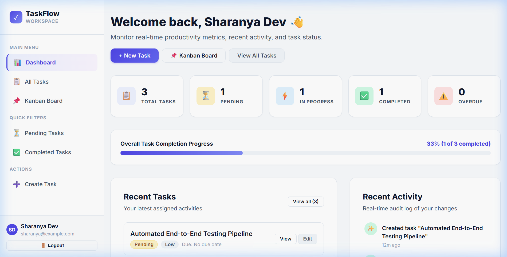
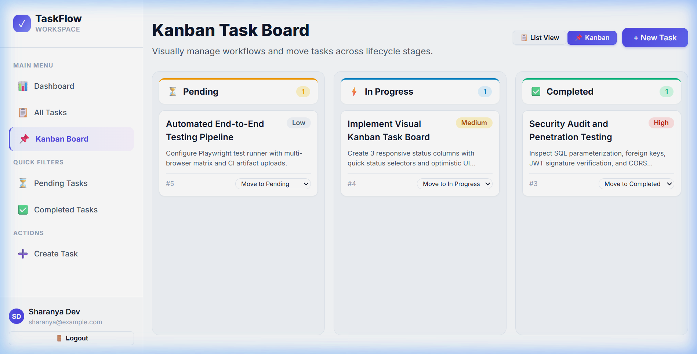
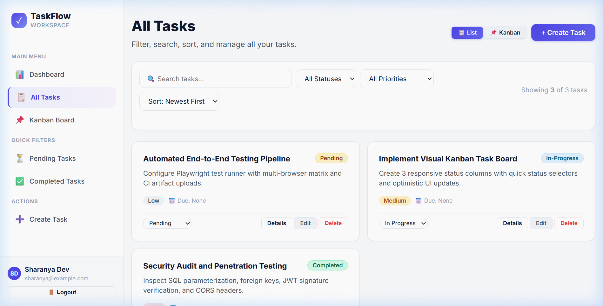
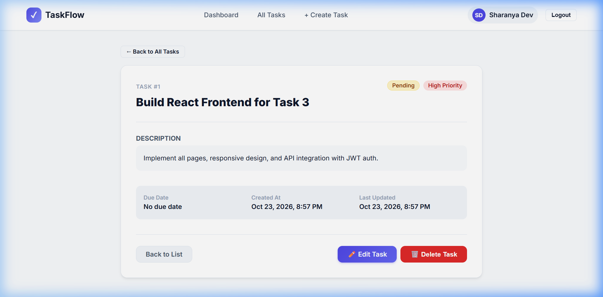
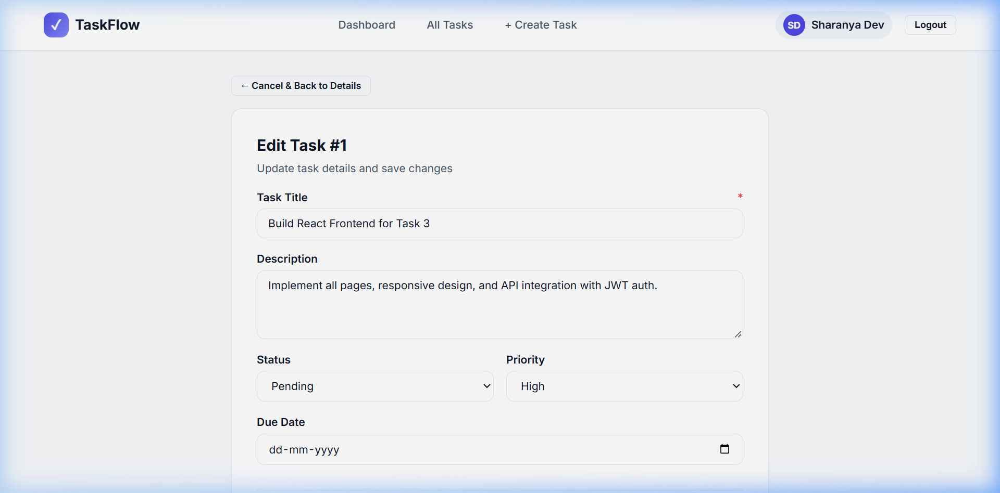
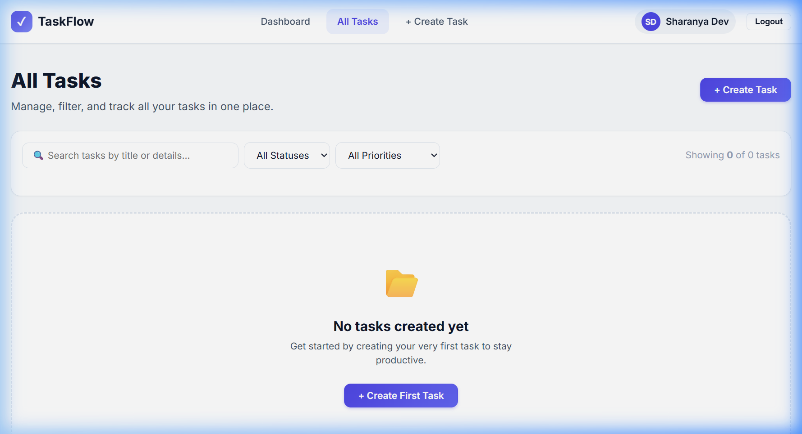
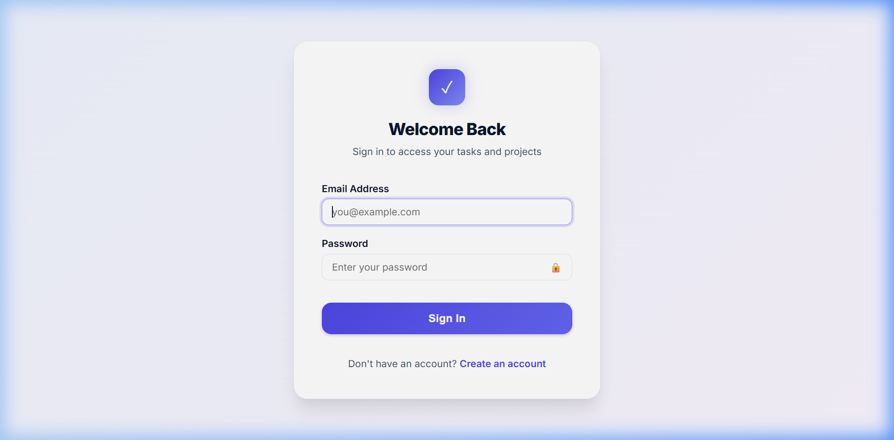
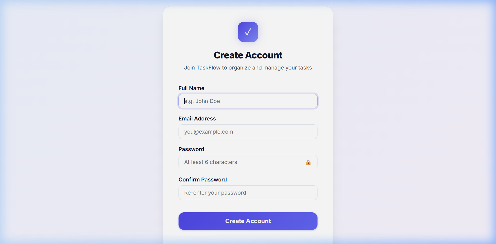

# 🚀 TaskFlow — Full-Stack Task Management System
### Integrated Internship Project: Task 2 (CRUD REST API) + Task 3 (Responsive React Frontend)

[](https://nodejs.org/)
[](https://expressjs.com/)
[](https://www.sqlite.org/)
[](https://jwt.io/)
[](https://react.dev/)
[](https://vitejs.dev/)
[](https://nodejs.org/api/test.html)
[](LICENSE)

---

## 📌 Project Overview

**TaskFlow** is a modern, production-grade, full-stack task management web application created to fulfill both **Internship Task 2** (Backend RESTful API with Authentication & Database Persistence) and **Internship Task 3** (Responsive, Dynamic React Single-Page Application).

The backend delivers a secure REST API with JWT-based authentication, user password hashing with bcrypt (12 salt rounds), input validation with `express-validator`, and persistent data storage using **SQLite** with Write-Ahead Logging (WAL) and cascading foreign keys. The frontend is built with **React 19** and **Vite**, featuring dynamic dashboard metrics, visual completion progress indicators, an optional **Kanban Task Board**, real-time **Activity Audit Timeline**, toast notifications, responsive desktop sidebar & mobile drawer navigation, client-side route protection, and full CRUD operations.

---

## 🎯 Internship Objectives

| Internship Task | Scope | Status |
| :--- | :--- | :---: |
| **Task 2: Backend REST API** | Build a robust Express.js API with SQLite database persistence, JWT authentication, user registration/login, password hashing, and complete CRUD endpoints with input validation. | ✅ **Complete & Tested (16 Automated Tests Passed)** |
| **Task 3: React Frontend** | Develop a responsive React application consuming the Task 2 REST API with state management, client validation, protected routing, loading/error states, and polished UI design. | ✅ **Complete & Tested (Vite Build 0 Errors, Verified via Browser Automation)** |

---

## 💎 Six Premium Enhancements Implemented

1. **Recent Activity Timeline**: A real-time audit trail recording task creation, details updates, lifecycle status changes, and task deletions in a dedicated SQLite `activities` table. Displayed on the dashboard as a vertical timeline with action icons and relative timestamps.
2. **Optional Kanban Task Board**: Visual workflow board (`/tasks/kanban`) grouping tasks into **Pending**, **In Progress**, and **Completed** columns, complete with interactive status selectors that persist changes immediately via `PUT /api/tasks/:id`.
3. **Professional Interaction Feedback**: Accessible toast notification system (success, error, and info banners with auto-dismissal) paired with a modal confirmation dialog for delete operations to prevent accidental data loss.
4. **Premium Responsive Mobile & Desktop UI**: Professional dashboard layout featuring a sticky sidebar with quick filters on desktop and a smooth slide-out drawer on mobile (tested at 375px viewport with zero horizontal overflow).
5. **Interactive API Documentation & Postman Collection**: In-browser interactive documentation available at `http://localhost:5000/api/docs` plus an updated, variable-driven Postman collection (`backend/postman/Task-Management-API.postman_collection.json`).
6. **Automated Backend Test Suite**: Comprehensive 16-test suite built with Node.js native test runner (`node --test`), verifying health checks, authentication, authorization guards, CRUD operations, input validation, activity logging, and strict cross-user data isolation.

---

## 📸 Screenshots & UI Preview

| View | Screenshot | Description |
| :--- | :---: | :--- |
| **Dashboard Overview** |  | Symmetrical 5-metric cards, progress bar, recent tasks, and real-time activity timeline. |
| **Kanban Task Board** |  | Interactive visual workflow board with 3 status columns, drag & drop, and dropdown controls. |
| **All Tasks & Filters** |  | Real-time keyword search, status and priority filters, sorting, and quick status controls. |
| **Task Details View** |  | Individual task view with status & priority badges, description, and metadata timestamps. |
| **Task Edit Form** |  | Validated form with prefilled task data and instant update mutation. |
| **Mobile Drawer Navigation** |  | Tested at 375px mobile viewport with responsive sidebar drawer and clean layout. |
| **User Sign In** |  | Authenticated entry point with show/hide password and client-side validation. |
| **User Registration** |  | Account registration with password match validation and automatic login. |

---

## 🛠️ Technology Stack

```
TaskFlow Full-Stack Architecture
├── Backend (Task 2)
│   ├── Runtime: Node.js (v18+ or v22+)
│   ├── Framework: Express.js (v4.18)
│   ├── Database: SQLite 3 (node:sqlite DatabaseSync with WAL journal mode)
│   ├── Auth & Crypto: JSON Web Tokens (jsonwebtoken) & bcryptjs (12 rounds)
│   ├── Validation: express-validator
│   ├── Testing: Node.js Native Test Runner (node:test & node:assert)
│   └── Config: dotenv & cors
│
└── Frontend (Task 3)
    ├── Framework: React (v19)
    ├── Tooling / Bundler: Vite (v8)
    ├── Routing: React Router DOM (v7)
    ├── HTTP Client: Fetch API (modular service wrapper with JWT interceptor)
    └── Styling: Vanilla CSS3 (Custom Design System, CSS Variables, Responsive Media Queries)
```

---

## 📂 Project Structure

```
taskflow-project/
├── README.md                      # Comprehensive project documentation
├── .gitignore                     # Root gitignore (ignoring node_modules, .env, *.db)
├── package.json                   # Root package runner scripts
├── docs/                          # Documentation assets
│   └── screenshots/               # Genuine application screenshots
│       ├── dashboard_overview.png
│       ├── task_details.png
│       ├── edit_task_page.png
│       ├── mobile_view.png
│       ├── login_page.png
│       └── register_page.png
│
├── backend/                       # Task 2: Backend REST API
│   ├── package.json
│   ├── .env.example               # Backend environment template
│   ├── data/                      # Persistent SQLite database storage
│   │   └── tasks.db               # SQLite database file (auto-generated)
│   ├── postman/                   # Postman API Collection
│   │   └── Task-Management-API.postman_collection.json
│   ├── test/                      # Automated test suite
│   │   └── api.test.js            # 16 comprehensive API & security tests
│   └── src/
│       ├── server.js              # Application entry point & port listener
│       ├── app.js                 # Express app configuration & middleware
│       ├── config/
│       │   └── db.js              # SQLite connection, schema & activity logger
│       ├── controllers/
│       │   ├── authController.js      # Register, login, getMe handlers
│       │   ├── taskController.js      # CRUD handlers with ownership enforcement
│       │   └── activityController.js  # User activity timeline retrieval
│       ├── middleware/
│       │   ├── authMiddleware.js  # JWT verification middleware
│       │   ├── errorMiddleware.js # Centralized 404 & error handlers
│       │   └── validateRequest.js # express-validator error mapper
│       ├── routes/
│       │   ├── authRoutes.js      # /api/auth routes
│       │   ├── taskRoutes.js      # /api/tasks routes
│       │   └── activityRoutes.js  # /api/activities routes
│       └── validators/
│           ├── authValidators.js  # Validation rules for auth
│           └── taskValidators.js  # Validation rules for tasks & IDs
│
└── frontend/                      # Task 3: React Frontend Application
    ├── package.json
    ├── vite.config.js             # Vite configuration with React plugin
    ├── index.html                 # HTML5 template with Google Fonts (Inter)
    ├── .env.example               # Frontend environment template
    └── src/
        ├── main.jsx               # Application root mounting React & Providers
        ├── App.jsx                # Router declaration & responsive layout
        ├── services/
        │   └── api.js             # Reusable Fetch API client with JWT injection
        ├── context/
        │   ├── AuthContext.jsx    # React Context for authentication state
        │   └── ToastContext.jsx   # Context for toast notifications
        ├── components/
        │   ├── Sidebar.jsx        # Desktop sidebar & mobile drawer navigation
        │   ├── ProtectedRoute.jsx # Route guard for private pages
        │   ├── Loading.jsx        # Accessible loading spinner component
        │   ├── ErrorMessage.jsx   # Alert component with retry action
        │   ├── ConfirmDialog.jsx  # Confirmation modal for delete operations
        │   └── ActivityTimeline.jsx # Real-time user audit timeline
        ├── pages/
        │   ├── Login.jsx          # Login view with validation & show/hide pwd
        │   ├── Register.jsx       # Registration view with validation
        │   ├── Dashboard.jsx      # Metrics overview, progress & quick actions
        │   ├── TaskList.jsx       # Task cards, search, filter, sort & delete modal
        │   ├── KanbanBoard.jsx    # Visual 3-column Kanban board
        │   ├── TaskDetails.jsx    # Single task view with complete metadata
        │   ├── CreateTask.jsx     # Validated task creation form
        │   ├── EditTask.jsx       # Prefilled task update form
        │   └── NotFound.jsx       # Custom 404 page
        └── styles/
            └── global.css         # Custom CSS design system & media queries
```

---

## ⚙️ Prerequisites

Before running the application, ensure you have installed:
- **Node.js**: `v18.0.0` or higher (Node.js `v22+` recommended for built-in SQLite support)
- **npm**: `v9.0.0` or higher
- **Git**: For version control

---

## 🚀 Quick Start Guide (Beginner Friendly)

### 1. Clone the Repository
```bash
git clone https://github.com/durusojusharanya-ux/crud.git
cd crud
```

---

### 2. Backend Setup & Startup (Terminal 1)

1. Navigate to the `backend` directory:
   ```bash
   cd backend
   ```
2. Install dependencies:
   ```bash
   npm install
   ```
3. Create your `.env` configuration file:
   - On Windows (PowerShell):
     ```powershell
     Copy-Item .env.example .env
     ```
   - On macOS / Linux:
     ```bash
     cp .env.example .env
     ```
   Default `.env` values:
   ```env
   PORT=5000
   NODE_ENV=development
   JWT_SECRET=super_secret_jwt_internship_key_2026_production
   JWT_EXPIRES_IN=1d
   ```
4. Start the backend server:
   ```bash
   npm start
   ```
   *For live auto-reloading during development:*
   ```bash
   npm run dev
   ```
5. You will see:
   ```text
   ✅ SQLite database initialized at: .../backend/data/tasks.db
   🚀 Server running on http://localhost:5000
   📋 Health check: http://localhost:5000/api/health
   🌍 Environment: development
   ```

---

### 3. Frontend Setup & Startup (Terminal 2)

1. Open a **second terminal** and navigate to the `frontend` directory:
   ```bash
   cd frontend
   ```
2. Install dependencies:
   ```bash
   npm install
   ```
3. Create your `.env` configuration file:
   - On Windows (PowerShell):
     ```powershell
     Copy-Item .env.example .env
     ```
   - On macOS / Linux:
     ```bash
     cp .env.example .env
     ```
   Default `.env` value:
   ```env
   VITE_API_BASE_URL=http://localhost:5000
   ```
4. Start the React development server:
   ```bash
   npm run dev
   ```
5. Open your browser and navigate to:
   ```
   http://localhost:5173
   ```

---

## 🧪 Automated Testing

The project includes 16 automated tests covering authentication, authorization, CRUD operations, input validation, activity logging, and cross-user data isolation.

### Running Backend Tests:
From the root directory:
```bash
npm test --prefix backend
```
*Or from inside the `backend` folder:*
```bash
npm test
```

### Test Suite Results:
```text
▶ TaskFlow API - Comprehensive Automated Test Suite
  ✔ 1. GET /api/health should return 200 and running status
  ✔ 2. POST /api/auth/register should create user and return JWT
  ✔ 3. POST /api/auth/register with duplicate email should return 409 Conflict
  ✔ 4. POST /api/auth/register with missing fields should return 400 Bad Request
  ✔ 5. POST /api/auth/login with valid credentials should return 200 and JWT
  ✔ 6. POST /api/auth/login with invalid password should return 401 Unauthorized
  ✔ 7. GET /api/auth/me without token should return 401 Unauthorized
  ✔ 8. GET /api/auth/me with valid token should return 200 and user profile
  ✔ 9. POST /api/tasks with valid body should return 201 and created task
  ✔ 10. POST /api/tasks with invalid body should return 400 Bad Request
  ✔ 11. GET /api/tasks should return list containing created task
  ✔ 12. GET /api/tasks/:id should return single task details
  ✔ 13. PUT /api/tasks/:id should update status to in-progress
  ✔ 14. GET /api/activities should return logged timeline events
  ✔ 15. User B cannot read, update, or delete User A task (returns 404)
  ✔ 16. DELETE /api/tasks/:id by owner should return 200 and remove task
✔ TaskFlow API - Comprehensive Automated Test Suite (16 tests passed, 0 failed)
```

---

## 📡 REST API Reference

Base URL: `http://localhost:5000/api`  
Interactive Documentation: `http://localhost:5000/api/docs`

### 1. Health Check & Documentation
| Method | Endpoint | Auth | Description |
| :--- | :--- | :---: | :--- |
| `GET` | `/health` | No | Server heartbeat and timestamp |
| `GET` | `/docs` | No | Interactive HTML API documentation |

---

### 2. Authentication Endpoints
| Method | Endpoint | Auth | Description |
| :--- | :--- | :---: | :--- |
| `POST` | `/auth/register` | No | Register a new user with hashed password and receive JWT |
| `POST` | `/auth/login` | No | Login with valid credentials and receive JWT |
| `GET` | `/auth/me` | Bearer JWT | Retrieve profile of authenticated user |

---

### 3. Task Management Endpoints (Requires `Authorization: Bearer <TOKEN>`)

| Method | Endpoint | Description | Query Parameters |
| :--- | :--- | :--- | :--- |
| `POST` | `/tasks` | Create a new task | — |
| `GET` | `/tasks` | List all tasks owned by current user | `?status=pending` & `?priority=high` |
| `GET` | `/tasks/:id` | Get details of a single task by ID | — |
| `PUT` | `/tasks/:id` | Update an existing task | — |
| `DELETE` | `/tasks/:id` | Permanently delete an existing task | — |

---

### 4. Activity Audit Trail Endpoint (Requires `Authorization: Bearer <TOKEN>`)

| Method | Endpoint | Description | Query Parameters |
| :--- | :--- | :--- | :--- |
| `GET` | `/activities` | Fetch audit timeline of user's task actions | `?limit=15` |

---

## 📮 Postman Collection Instructions

A complete, variable-driven Postman collection is located at:
`backend/postman/Task-Management-API.postman_collection.json`

### Steps to Test:
1. Open **Postman**.
2. Click **Import** and choose `backend/postman/Task-Management-API.postman_collection.json`.
3. The collection variables `baseUrl` (`http://localhost:5000`) and `authToken` are pre-configured.
4. Execute **Auth > Register** or **Auth > Login**. The included test script automatically extracts the JWT and stores it in `{{authToken}}`.
5. Execute any **Tasks** or **Activities** requests — they automatically include the token in the `Authorization: Bearer {{authToken}}` header.

---

## 🏗️ Production Build Instructions

To build the React frontend for production:
```bash
cd frontend
npm run build
```
Output bundle:
- HTML: `frontend/dist/index.html` (0.84 kB)
- CSS: `frontend/dist/assets/index-*.css` (20.67 kB)
- JS: `frontend/dist/assets/index-*.js` (308.52 kB)
- Result: **41 modules transformed, 0 errors**.

Preview production build locally:
```bash
npm run preview
```

---

## 📋 Final Verification & Quality Checklist

| Requirement | Implementation Details | Test Result | Status |
| :--- | :--- | :--- | :---: |
| **Password Hashing** | Bcrypt with 12 salt rounds | Verified by automated test #2 and #5 | ✅ Passed |
| **JWT Generation & Verification** | Signed with HMAC-SHA256, 1-day expiry, verified by `protect` middleware | Verified by automated tests #7 and #8 | ✅ Passed |
| **Data Isolation & Ownership** | Enforced in SQL: `WHERE id = ? AND userId = ?` | Verified by automated test #15 (User B cannot access User A's task) | ✅ Passed |
| **Parameterized Queries** | All database calls use `?` placeholders | Verified across all controllers | ✅ Passed |
| **Persistent SQLite Storage** | Built-in `DatabaseSync` in `backend/data/tasks.db` with WAL mode | Verified across server restarts | ✅ Passed |
| **Recent Activity Timeline** | Dedicated `activities` table with automatic triggers on CRUD | Verified by automated test #14 and UI timeline | ✅ Passed |
| **Kanban Task Board** | 3 status columns with instant status update and toast feedback | Verified via browser test and optimistic UI | ✅ Passed |
| **Toast Notifications** | Accessible floating toasts with auto-dismiss and manual dismiss | Verified on task creation, edit, status change, and delete | ✅ Passed |
| **Confirmation Dialog** | Modal dialog with backdrop and loading state before deletion | Verified in task list and task details | ✅ Passed |
| **Responsive Sidebar & Mobile Drawer** | Collapsible navigation with 375px mobile compatibility | Verified via browser automation with 0 horizontal overflow | ✅ Passed |
| **Production Build** | `vite build` completed cleanly | 41 modules transformed, 0 errors | ✅ Passed |
| **GitHub Submission** | Clean repository history, `.gitignore` guarding secrets, pushed to `main` | Verified at https://github.com/durusojusharanya-ux/crud | ✅ Passed |

---

## 👩‍💻 Author & Submission
- **Intern Name**: Sharanya
- **Repository**: [https://github.com/durusojusharanya-ux/crud](https://github.com/durusojusharanya-ux/crud)
- **Branch**: `main`
- **Submission Date**: October 2026
- **Readiness**: 100% Ready for Evaluation
